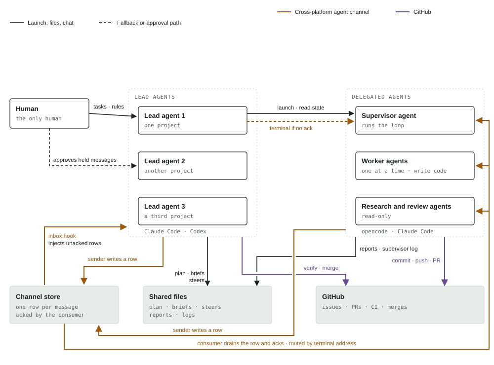

# Agent Switchboard

<picture><source media="(prefers-color-scheme: dark)" srcset="assets/switchboard-map-dark.svg"></picture>

## What this is

A mailbox with acks between agents on three runtimes (Claude Code, opencode and Codex) on one machine, kept in a SQLite file on disk. When the recipient has no mailbox consumer, the sender falls back to typing into the recipient's terminal and proving the text landed. A tab launcher opens delegated agents with their briefs and confirms they started.

## The two channels

- Cross-platform agent channel: this repo — a store on disk plus the terminal fallback.
- The shared record: issues, pull requests, checks and merges; messages point at it and do not replace it.

## What each line is built on

| Line | Built on | Where |
|---|---|---|
| Cross-platform channel: the store | One row per message in a SQLite file on disk (`$AGENT_SWITCHBOARD_DIR/state.db`); JSONL files under `mailbox/` only while a legacy pin is set (see Store below). The sender resolves the recipient's window and waits for the ack row. | `bin/agent-send.mjs`, `lib/agent-mailbox.mjs`, `lib/store.mjs` |
| Cross-platform channel: the consumers | A hook inside each agent reads unacked rows and acks them: at each prompt in Claude Code and Codex, after each Claude Code tool call, and at each Claude Code Stop. The opencode consumer is a plugin in the companion configuration repo, not here. | `hooks/claude/mailbox-inject.mjs`, `hooks/claude/mailbox-tool.mjs`, `hooks/claude/mailbox-stop.mjs`, `hooks/codex/mailbox.mjs` |
| Terminal if no ack | Terminal remote control: types the message into the window. Delivery is proven by a new inbound row in that tab's session file. | `bin/kitty-send.sh` |
| Launch | Terminal remote control: opens a titled tab running the agent with its brief, confirms it started, and refuses to close a window it did not launch; details in [`docs/launchers.md`](docs/launchers.md). | `bin/opencode-tab.sh`, `bin/claude-tab.sh`, `bin/claude-resume-set.sh`, `lib/tab-ledger.sh` |
| Read state | Not the screen but the disk: the window's process and the runtime's own session record: a Claude Code window is read from Claude's session record (`status` busy or idle) and transcript, an opencode window from opencode's session database. Any other window reads as `unknown`. | `bin/tab-state.sh` |
| Drill | Nightly end-to-end check that a send reaches a live seat idle, busy, at a permission prompt, on a slash command and closed, with an optional PR merge stage; details in [`docs/fleet-drill.md`](docs/fleet-drill.md). | `bin/fleet-drill.mjs` |
| Files | Plain files every agent can read: plan, briefs, steers, reports, logs. | a directory the agents share |
| Shared record | The `gh` command line: issues, pull requests, checks, merges. | `gh` |
| Approval path | The host agent's own hold screen for a message between sessions in different permission modes. | The host agent's settings file |

## Install

The hooks below plug into the Claude Code and Codex runtimes, and the sender, fallback and launcher drive kitty; all three must be present for the full channel, while mailbox-only mode works anywhere node runs.

```sh
git clone <repo-url> ~/agent-switchboard
export PATH="$HOME/agent-switchboard/bin:$PATH"
```

`<checkout>` below is where you cloned it. Keep that checkout in place: the hooks import their siblings by relative path, so a hook file copied out on its own breaks.

### Host agent: the inbox hook

Add the repo's hook file, in place, to the existing `UserPromptSubmit` hook list in `settings.json`:

```json
{
  "hooks": {
    "UserPromptSubmit": [
      {
        "hooks": [
          { "type": "command", "command": "node <checkout>/hooks/claude/mailbox-inject.mjs" }
        ]
      }
    ]
  }
}
```

The hook reads this session's unacked rows by session id, acks each with `prompt`, prints them as turn context, and refreshes this session's presence entry so senders route here instead of the terminal. It always exits 0 and prints nothing when the inbox is empty.

### Host agent: the tool-boundary drain

A seat in a long autonomous turn makes dozens of tool calls and gets no prompt until the turn ends. Add the hook, in place, to the `PostToolUse` list in `settings.json` (no `matcher`, so it runs after every tool):

```json
{
  "hooks": {
    "PostToolUse": [
      {
        "hooks": [
          { "type": "command", "command": "node <checkout>/hooks/claude/mailbox-tool.mjs" }
        ]
      }
    ]
  }
}
```

After each tool call the hook reads this session's unacked rows by session id, acks each with `tool` before printing, and prints them as `hookSpecificOutput.additionalContext`. It prints nothing when the inbox is empty, does not refresh presence or claim roles, and always exits 0. A row that could not be acked is not shown and waits for the next prompt or Stop.

### Host agent: the Stop drain

A row queued for a seat that is mid-turn would otherwise wait for the next prompt, and an idle seat never gets one. Add the Stop hook, in place, to the `Stop` list in `settings.json`:

```json
{
  "hooks": {
    "Stop": [
      {
        "hooks": [
          { "type": "command", "command": "node <checkout>/hooks/claude/mailbox-stop.mjs" }
        ]
      }
    ]
  }
}
```

When the turn ends the hook reads this session's unacked rows, acks each with `stop` before printing, and prints `{"decision":"block","reason":...}` so the seat continues with the messages. The acks bound the loop: a second Stop finds nothing. It prints nothing when the inbox is empty, does not refresh presence or claim roles, and always exits 0.

### Codex desktop: the inbox hook

Add the switchboard hook to the existing `SessionStart`, `UserPromptSubmit`, and `SessionEnd` lists in `~/.codex/hooks.json`. Keep the existing handlers; Codex loads all matching hook sources. If this machine uses a switchboard environment bootstrap, preload it before the hook so the Codex app uses the same SQLite store as the other agents:

```json
{
  "hooks": {
    "SessionStart": [{ "hooks": [{ "type": "command", "command": "node --import <switchboard-env.mjs> <checkout>/hooks/codex/mailbox.mjs" }] }],
    "UserPromptSubmit": [{ "hooks": [{ "type": "command", "command": "node --import <switchboard-env.mjs> <checkout>/hooks/codex/mailbox.mjs" }] }],
    "SessionEnd": [{ "hooks": [{ "type": "command", "command": "node --import <switchboard-env.mjs> <checkout>/hooks/codex/mailbox.mjs" }] }]
  }
}
```

For a standalone installation without a bootstrap, omit `--import <switchboard-env.mjs>`. Codex supplies a stable `session_id` and `cwd` to the hook. The hook registers that identity as a consumer, adds pending messages as context on the next submitted prompt, acknowledges them, and releases the beacon at session end. Codex has no lifecycle event for an external mailbox write, so a reply sent while its chat is idle waits until the next prompt. Review and trust the hook definition in Codex before relying on it; changed non-managed hooks are skipped until trusted.

### Seat roles

A window id dies with its window; a **seat role** names the seat itself, and `--to role:<name>` follows whichever session holds it (`agent-send.mjs --claim-role <name>`, `--release-role <name>`, `--who`). Claim, release, send, idle-seat and nudge rules: [`docs/seat-roles.md`](docs/seat-roles.md).

### Sending and launching

```sh
# Steer another agent; exit 0 means acked or proven, 3 means not delivered yet (do not resend),
# 10 and 16 mean typed but not proven (look at the window before resending); any other code is kitty-send.sh's.
agent-send.mjs --to <window-id|title-substring|mailbox-key|role:name> (--text TEXT | --file /abs/path) [--now | --stop | --idle-when REGEX | --queue] [--deadline N] [--no-wait] [--verbose]
agent-send.mjs --read [--as <session-id>]   # print and ack this session's inbox rows (incl. held roles' queues)
agent-send.mjs --cancel --id <r> [--to <key>] # withdraw one queued row; the id alone is enough, the row's own recipient is used (exit 13: already delivered or withdrawn, 14: no such row)
agent-send.mjs --to role:<name> --text TEXT # address a seat role; it survives a seat change
agent-send.mjs --claim-role <name> [--take-over]  # hold a role; exit 11 if a live seat holds it
agent-send.mjs --release-role <name>              # give up a role this session holds; exit 12 if another holds it
agent-send.mjs --who [--json]               # live seats: window, session, cwd, repo, branch, roles, title
# A multi-line --text reaches a mailbox consumer whole; on the kitty fallback it becomes a --file note
# under ~/.local/state/agent-switchboard/notes/. The process title hides the text from `pkill -f`.

# Open a titled tab with its brief and confirm it started (exit 2 means no terminal remote control): --model is required, and a session on another model closes the tab (exit 3).
# Both launchers share --list (the tabs this machine launched) and --close <window-id> (refuses a window it did not launch).
opencode-tab.sh --title "opencode: <what this is>" --brief /abs/brief.md --model PROVIDER/NAME[#VARIANT] [--out /abs/out.md] [--cwd /abs/repo] [--slot-override "<reason>"] [--server URL] [--no-probe]   # probes the model first; --server opens the tab on a shared opencode server
claude-tab.sh --title "claude: <what this is>" --brief /abs/brief.md --model opus|sonnet|haiku|fable|claude-ID [--rc [NAME]] [--out /abs/out.md] [--cwd /abs/repo] [--slot-override "<reason>"]
claude-tab.sh --resume <session-id> --title "claude: <name>" --model ... [--rc [NAME]] [--brief /abs/brief.md]   # reopen a session as a seat, proven past the old rows

# Before a reboot: record the live Claude Code sessions; after it, reopen each one, proven, through claude-tab.sh --resume.
claude-resume-set.sh --snapshot [/abs/file.json]
claude-resume-set.sh --replay [/abs/file.json] [--dry-run]

# What a tab is doing, read from disk, never the screen.
tab-state.sh <window-id> [--json] [--watch [--interval=S]]
```

`--topic SLUG` (`[a-z0-9][a-z0-9._-]{0,63}`) makes a broadcast one delivery per recipient: sending withdraws every earlier unacked message with the same topic to that recipient, from any sender, and the readers collapse a send race to the newest row, rendered with ` (supersedes N)`. Use it where only the latest copy matters (a RESUME to every seat, a round's question), so a seat that wakes to two senders spends one turn, not two; a message without a topic never collapses. A typed kitty fallback also leaves an acked row (`via: "typed"`), so the store sees every delivery; a `--topic` send whose topic was already delivered to the recipient within `--topic-window MIN` (default 60) sends nothing, prints `already delivered: topic <t> at <ts> from <sender>` and exits 15 (suppressed, nothing sent; 0 would read as delivered). `--force-topic` or a zero `--topic-window` sends anyway.

By default a send prints exactly one stderr line, the final verdict, on every exit (including a kitty-send exit 0 "delivered" and exit 3 "typed, not proven") (for a queued row: `queued for <recipient>, delivered at its next tool call ... (id N; exit 3 ...)`; a re-queue after kitty-send sent nothing carries its reason, `(not typed: <reason>)`, and a seat stuck on a dialog or a draft is not promised a tool-call delivery). A `--queue` send, which can wait unbounded, also prints one `queued <id> ... waiting for delivery` line as soon as the row is written, so a caller killed mid-wait still has the id to `--cancel`. kitty-send's own stderr is trace in this mode, except the reason of a failure agent-send cannot explain itself. `--verbose` or `AGENT_SEND_VERBOSE=1` adds the step-by-step trace. `--queue` waits for the recipient's drain (that is how an idle seat gets the row typed in), which can take minutes against a busy seat; `--no-wait` returns exit 3 as soon as the row is written and leaves delivery to the recipient's own drain: it never types, even to an idle seat, and a target with no mailbox to queue in fails (exit 1) rather than falling back to kitty. It refuses `--now`, `--stop`, `--idle-when` and `--deadline` (exit 2). With `AGENT_SEND_NOTICE_ROLE` set to a role name, a send to a `role:<name>` that nobody holds also leaves that role a one-line notice that the mail has no reader (see `docs/configuration.md`).

`--now` (the default) and `--stop` never type into a busy seat: the row goes to the mailbox and is taken at the seat's next tool call, and a typed fallback happens only when the window is not busy.
Busy follows the order of kitty-send's busy check for the two signals they share: the Claude Code session record first, the title spinner only without a record.
It does not read the tab-state script or the `--idle-when` screen proof, which kitty-send also uses.
The record has no staleness bound: a stale `busy` record keeps its window busy, and the row waits for its drain. A seat that sits idle behind such a record is therefore never typed into: the text is held (mailbox row, or `kitty-send --queue` with no mailbox) until the record changes, and the sender sees exit 3 (pending), never a delivery. Typing into it anyway is the one thing a bare send must not do, since a seat that is really mid-turn loses its in-flight tool result.
A busy window with no mailbox to park the row in is held by `kitty-send --queue`, which types the text at the seat's next idle point: one line, exit 3 (pending, do not resend), never exit 1 and never `--now`.
The same hold covers the race where the guard read the window as not busy but kitty-send's own state check finds it mid-turn (kitty-send exit 7, nothing sent): a bare send then starts `kitty-send --queue` and prints one pending line (held, do not resend), never a failure line. A seat with a mailbox gets a withdrawable row instead (`--cancel --id`). Only a window with no mailbox gets a detached waiter, which has no row, so `--cancel --id` cannot withdraw it; use `kitty-send.sh --cancel --to <window>`.
`--stop` is an alias of `--now` here: on a busy seat nothing is interrupted, and the one verdict line says so.
`--idle-when` is the caller's own parked proof and outranks every busy signal, so it is never held back by this guard; `--queue` waits for its own parked proof.
`--queue` never interrupts a turn and never waits on a seat that is provably idle: while the recipient's window shows it mid-turn the row stays queued for its own drain (next tool call or turn end).
Once the window has shown idle for `AGENT_SEND_IDLE_WAIT_S` (5 s) without the row being taken, the sender types the row in through `kitty-send.sh --wait-idle`, but only on positive proof of all of: no spinner in the title, a Claude Code session record whose status is `idle` or `shell` (the turn ended and a background shell still runs; `waiting`, `blocked`, an unknown status or no record is not idle), a readable screen with no dialog footer in its bottom rows (question, plan approval), and an empty composer box (the prompt line and every line under it up to the closing rule).
Text that starts with `/` is never typed this way, since it would run as a command in the seat.
A send to a seat idle past the presence window (`kitty-send` fallback) needs the same proof; without it nothing is typed and the text is queued for the seat's own drain.
Anything else, including "could not tell", leaves the row queued and prints one line naming the reason (`queued for <recipient> (not typed: <reason>) ...`; the longer `not typed into window` form is part of the `--verbose` trace).
Only Claude Code tabs are ever typed into this way: the composer of any other kind of tab cannot be read reliably, so those keep the row queued.
A fresh session whose placeholder hint fills the prompt line reads as a draft and is not typed into either.
So `--queue` is safe to any seat with a kitty window, idle or busy; a recipient with no window to read still waits for its own drain.
The proof is also run again by `kitty-send.sh` itself, immediately before its first keystroke, in every mode that claims the seat is idle (`--queue`, `--wait-idle`, `--deadline`, the detached waiter; not `--idle-when`, whose caller states its own parked proof and which is checked for a dialog only), and in front of the stranded-chip recovery's Enter.
A tab with no Claude Code process (shell, REPL, pi, OpenCode) is checked for a dialog only, since its composer cannot be read.
A `/` text is refused by agent-send for a `--queue` send (mailbox and fallback) but not by kitty-send itself, so an explicit `kitty-send.sh ... --text "/rename x"` goes through.
The `--queue` kitty fallback runs kitty-send in the foreground, so a refusal reaches the sender: the text is queued for the seat (exit 3) or the send fails.
The exception is a seat with no mailbox consumer that is busy, or a tab that is not Claude Code: with no mailbox to park the row in, it is handed to kitty-send's detached `--queue` waiter (exit 3, pending), which re-proves at typing time and keeps polling while a refusal is a not-idle-yet one (a draft, a placeholder hint); with no deadline it never drops the text.
So the withdraw path after `--deadline` runs out, and any caller that skipped its own check, cannot type onto a draft or a slash command either (exit 11, nothing typed, and the sender puts the row back in the mailbox).
When `--deadline` runs out against a seat that looks idle but fails the proof, the row is not even withdrawn: it stays queued and the sender exits 3.
A dialog (the record status `waiting` or `blocked`, or a dialog footer on screen) is refused in every mode, `--now` included (exit 4).
`--now` does not read the composer, so it still types onto a draft, by design.
The remaining window is the few milliseconds between kitty-send's proof and its first keystroke.
After an unacked wait the sender withdraws the mailbox row and falls through to `bin/kitty-send.sh`, which types the text plus carriage return in one call and proves it by a new inbound row in the tab's session file.
A Claude Code tab is the exception (#38): its composer swallows the carriage return of a long one-line send, so kitty-send types the text alone and then a lone carriage return (a second one at most), and proves it by a new user row carrying the text in the session's transcript, found through the session record the agent keeps per pid.

## Configuration

Every environment variable, its default and its reader, plus the timers: [`docs/configuration.md`](docs/configuration.md). Exit codes: [`docs/exit-codes.md`](docs/exit-codes.md).

## Store (SQLite) and retention

The mailbox and presence beacons live in one SQLite file (`AGENT_SWITCHBOARD_DB`, default `$AGENT_SWITCHBOARD_DIR/state.db`, WAL mode, 5 s busy timeout). `lib/store.mjs` picks `node:sqlite` under node and `bun:sqlite` under Bun at runtime, so the Node scripts and a Bun hook read and write the same file; `bin/switchboard-export.mjs <mailbox|presence|meta>` dumps any table as JSON for hand inspection, and exits 2 when no file is at the store path rather than printing an empty table.

Backend choice, in order: an explicit `{dir}` / `{file}` override means JSON files (the hermetic path the tests exercise); else an explicit `AGENT_SWITCHBOARD_DB` wins and the store backs everything; else the legacy `AGENT_SWITCHBOARD_MAILBOX_DIR` / `AGENT_MAILBOX_DIR` / `AGENT_SWITCHBOARD_PRESENCE_FILE` pins keep the JSONL backend while set. The store's first open imports the legacy files once (recorded in the `meta` table, so a second open imports nothing) and leaves them in place.

Retention, enforced by `pruneStale`: acked or cancelled rows are deleted 14 days after their ack/withdraw marker, markers included. Unacked rows are never deleted by retention — a closed session's rows survive it, so a probe's evidence outlives its session. A session-less run (no session id) records nothing: the consumer hook writes no beacon and starts no idle watcher, so it leaves no rows or beacons behind.

## Limits, plainly

- Same machine only. The store is files on disk and the fallback types into a local window; nothing here crosses a network boundary.
- Kitty remote control must be on for the fallback and the launcher. Without it the launcher exits 2, which tells the caller to fall back to headless and say so, and the sender falls back: where the recipient has a mailbox key the row stays queued (exit 3, id on the line); a window target with no mailbox key queues nothing and exits 1. Either way one stderr line tells a calling Claude Code session to deliver with `ListAgents` plus `SendMessage({to: "<session name>", message})` and, if a row is queued, to withdraw it with `--cancel --id <id>`.
- Mailbox-only mode works anywhere node runs: set `AGENT_SWITCHBOARD_DIR`, wire one hook, and `agent-send.mjs --queue` never needs a terminal.
- A message between host-agent sessions in different permission modes waits for the human's approval, and that hold is visible only to the human. Silence is not delivery: a held message is invisible to the receiving agent.
- Anything injected into a joined session leaves the machine — a guest sees the host's whole history, including what the machine injected into it. Never share a session link beyond the people who may read that history.

## Patterns

[`docs/patterns.md`](docs/patterns.md) recasts the eight observed and proposed exchanges as prose plus step lists: steering down a chain, delivery that never drops, a lease on one scarce slot, two leads editing one shared document, escalation from a held message to a policy, research with evidence-checked review, correction propagation to every copy, and a reply that finds its asker across runtimes. Each step says how its delivery is proven.
